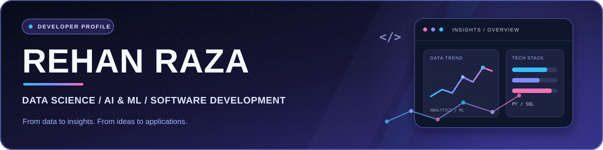

<!--
  REHAN RAZA | GitHub Profile README
  Visual direction: Graphite Grove — emerald, mint and warm gold
-->

  

  <h2>From data to insights. From ideas to applications.</h2>
  
<em>Computer Science undergraduate focused on Data Science, intelligent systems and practical software.</em>

  
<strong>Galgotias University · B.Tech CSE (Data Science) · Class of 2027 </strong>

  

    <a href="https://rehanraza009.github.io/portfolios/#hero" title="Visit Rehan's portfolio"><strong>Explore Portfolio ↗</strong></a>
    &nbsp; · &nbsp;
    <a href="https://www.linkedin.com/in/rehan-raza-b45bb630" title="Connect with Rehan on LinkedIn"><strong>LinkedIn ↗</strong></a>
    &nbsp; · &nbsp;
    <a href="mailto:099rehan@gmail.com" title="Send Rehan an email"><strong>Contact Me ↗</strong></a>
  

  

 

  <a href="#about" title="Jump to about section">About</a> &nbsp; ◦ &nbsp;
  <a href="#recognition" title="Jump to recognition section">Recognition</a> &nbsp; ◦ &nbsp;
  <a href="#projects" title="Jump to projects section">Projects</a> &nbsp; ◦ &nbsp;
  <a href="#experience" title="Jump to experience section">Experience</a> &nbsp; ◦ &nbsp;
  <a href="#toolkit" title="Jump to toolkit section">Toolkit</a> &nbsp; ◦ &nbsp;
  <a href="#learning" title="Jump to learning section">Certifications</a>

 

---

## 👋 A little about me

I'm **Rehan Raza**, a **B.Tech Computer Science and Engineering student specialising in Data Science** at **Galgotias University**, with an expected graduation year of **2027**.

I enjoy working where **data, AI and software engineering** meet. I use Python, SQL, Java and modern development technologies to explore datasets, build APIs, experiment with machine-learning approaches and develop applications that address practical problems.

My goal is to turn technical knowledge into reliable, useful solutions while continuing to grow as an engineer and analyst.

 

  <strong>EDUCATION</strong> 
  B.Tech · Computer Science & Engineering (Data Science) 
  Galgotias University · Expected 2027
    
 
  <strong>CAREER INTERESTS</strong> 
  Data Analyst · Data Scientist · AI/ML Engineer · Software Developer

 

---

## 🏆 Highlights & Recognition

  
  &nbsp;
  

 

### 🚀 Smart India Hackathon 2026

**Top 51 teams out of 150 participants**

Team **SatVision** was selected among the Top 51 teams from 150 participating teams for the grand-finale stage.

 

### 📈 Bluestock Fintech — Internship Project Outcomes

Contributed to project improvements associated with:

  
  &nbsp;
  

Performance and engagement figures were reported as outcomes of the Bluestock Fintech internship project.

 

---

## 🚀 Selected Work

  
<strong>8 PROJECTS · AI &amp; DATA · FULL-STACK · MOBILE APPLICATIONS</strong>

  
Explore selected work across remote sensing, investigation intelligence, mobility, AgriTech and application development.

 

### ✦ Featured Projects

<table>
  <tr>
    <td width="50%" valign="top">
      

      <h3>🛰️ SatQuery-AI</h3>
      
<strong>AI-Powered Multimodal Satellite Imagery Intelligence</strong>

      
A remote-sensing platform that lets users ask natural-language questions about satellite imagery. It combines image understanding, multi-temporal change detection and workflows for optical and Synthetic Aperture Radar (SAR) imagery.

      
<strong>Core capabilities</strong> 
      • Natural-language visual question answering 
      • Bi-temporal change detection using Siamese U-Net 
      • Optical and SAR data processing and fusion 
      • Model and task routing for remote-sensing analysis

      
<strong>Technology</strong> 
      <code>Next.js</code> <code>FastAPI</code> <code>Python</code> <code>PyTorch</code> <code>Hugging Face</code>

      

      Team SatVision — SIH 2026, Top 51 teams from 150.
    </td>
    <td width="50%" valign="top">
      

      <h3>🕵️ CrimIntel</h3>
      
<strong>AI-Powered Criminal Network Analysis System · SIH26189</strong>

      
An investigation-support system concept that organises fragmented records into connected, explainable entities and relationships. A temporal knowledge graph and evidence provenance help analysts review potential links across records.

      
<strong>Core capabilities</strong> 
      • Named-entity and relationship extraction 
      • Entity resolution across investigation records 
      • Temporal knowledge-graph construction 
      • Network analysis and evidence provenance

      
<strong>Technology</strong> 
      <code>Next.js</code> <code>React</code> <code>TypeScript</code> <code>Supabase</code> <code>PostgreSQL</code> <code>NLP</code>

      

      Decision-support concept; it does not determine guilt or automatically classify people as criminals.
    </td>
  </tr>
  <tr>
    <td width="50%" valign="top">
      

      <h3>🚗 RideMesh</h3>
      
<strong>AI-Powered Dynamic Carpooling &amp; Real-Time Mobility</strong>

      
A mobile mobility application designed to help people travelling in similar directions discover compatible rides. Matching considers route overlap, departure time, detours, pickup convenience and seat availability.

      
<strong>Core capabilities</strong> 
      • Route and destination compatibility 
      • Departure-time and seat-availability matching 
      • Driver detour and pickup-point considerations 
      • Ride coordination and tracking workflows

      
<strong>Technology</strong> 
      <code>React</code> <code>JavaScript</code> <code>Vite</code> <code>Capacitor</code> <code>Firebase</code> <code>Google Maps</code>

      

    </td>
    <td width="50%" valign="top">
      

      <h3>🌾 KisanSetu</h3>
      
<strong>Digital Marketplace Connecting Farmers and Customers</strong>

      
An Android application concept connecting farmers, customers and delivery partners through a digital produce marketplace, with tools to manage product listings and access agricultural information.

      
<strong>Core capabilities</strong> 
      • Farmer product listings with images and prices 
      • Customer browsing and ordering workflows 
      • Delivery-partner order management 
      • Crop-price information and plant-disease analysis

      
<strong>Technology</strong> 
      <code>Java</code> <code>Android</code> <code>Firebase</code> <code>OpenStreetMap</code> <code>OSMDroid</code>

      

    </td>
  </tr>
</table>

 

### ✦ More Projects

<table>
  <tr>
    <td width="50%" valign="top">
      <h3>📈 Machine Learning Stock Analysis</h3>
      
Full-stack stock-analysis application combining a Next.js interface, backend API routes and Python-based machine-learning scripts to explore stock-market data.

      
<strong>Stack:</strong> <code>Next.js</code> <code>React</code> <code>Node.js</code> <code>Python</code> <code>SQL</code>

      <a href="https://github.com/Rehanraza009/machine-learning-stock-analysis" title="Explore Machine Learning Stock Analysis repository">View repository →</a>
    </td>
    <td width="50%" valign="top">
      <h3>📝 TestHub — Online Examination System</h3>
      
Web-based examination platform with separate admin and student workflows for exam creation, question management, assessments, authentication and result viewing.

      
<strong>Stack:</strong> <code>HTML</code> <code>CSS</code> <code>JavaScript</code> <code>Firebase</code>

      <a href="https://github.com/Rehanraza009/TestHub" title="Explore TestHub repository">View repository →</a>
    </td>
  </tr>
  <tr>
    <td width="50%" valign="top">
      <h3>📊 IPO Web Application</h3>
      
IPO-focused web application and REST API development contributed to during the Bluestock Fintech internship.

      
<strong>Stack:</strong> <code>Python</code> <code>Django</code> <code>PostgreSQL</code>

      <a href="https://github.com/Rehanraza009/ipo-web-app-Final" title="Explore IPO Web Application repository">View repository →</a>
    </td>
    <td width="50%" valign="top">
      <h3>🤖 JARVIS — Desktop Voice Assistant</h3>
      
Python desktop assistant with multilingual voice interaction, hands-free conversation modes and Windows application automation.

      
<strong>Stack:</strong> <code>Python</code> <code>PySide6</code> <code>Speech Recognition</code> <code>Text-to-Speech</code>

      <a href="https://github.com/Rehanraza009/JARVIS" title="Explore JARVIS repository">View repository →</a>
    </td>
  </tr>
</table>

 

---

## 💼 Professional experience

### Data Analytics Intern
**VisioTechon Services**  
October 2026 – December 2026 · 3-month internship

- Supporting data analysis and business-oriented reporting activities.
- Working with **Excel-based data handling** and website-related analysis tasks.
- Organising and analysing information to communicate useful findings.
- Translating business questions into structured analytical tasks.

**Focus:** Data Analysis · Microsoft Excel · Data Handling · Reporting

 

### Software Development Engineer (SDE) Intern
**Bluestock Fintech**  
July 2025 – September 2025

- Developed and contributed to backend components for an **IPO web application and REST API** using **Python, Django and PostgreSQL**.
- Worked on API endpoints, server-side application logic and relational database integration.
- Supported application performance and user-experience improvements through backend development.

**Technology:** Python · Django · PostgreSQL · REST APIs

**Reported project outcomes**

  <h2>35% API response-time improvement</h2>
  <h2>40% increase in user engagement</h2>

 

---

## 🧰 Technical Skills

A focused overview of the languages, analytics tools, frameworks, databases and platforms used across my projects and learning.

 

### Programming Languages

  
  
  
  
  
  

 

### Data Analytics & Data Science

  
  
  
  
  
  

 

### Machine Learning & Artificial Intelligence

  
  
  
    
  
  
  
  

 

### Web & Backend Development

  
  
  
  
  
  
    
  
  

 

### Databases, Cloud & Developer Tools

  
  
  
  
  
    
  
  
  
  

 

## 📜 Certifications & learning

**Cloud computing & data engineering**
- AWS Technical Essentials — Amazon Web Services · August 2026
- Data Engineering on AWS – Foundations — Amazon Web Services · August 2026
- AWS ML Engineer Associate Curriculum Overview — Amazon Web Services · August 2026

### ⭐ Featured Course · Remote Sensing & Geospatial AI

  

  <strong>Geospatial Artificial Intelligence · Satellite Data · Machine Learning</strong> 
  Completed through the Indian Institute of Remote Sensing (IIRS), ISRO.

 

**Programming & database technologies**
- Database Design — Oracle Academy
- Alpha DSA with Java — Apna College
- Data Science using Java — Galgotias University Prerequisite Programme

**Design & innovation**
- Design Thinking — IIT Madras

  <a href="https://github.com/Rehanraza009/My-Certification" title="Open GitHub repository or profile"><strong>Browse all certificates and learning records →</strong></a>

 

---

## 📊 GitHub activity

  
  &nbsp;&nbsp;
  
    
  

  Streak image is generated from the GitHub contribution graph and refreshed daily by this repository's GitHub Actions workflow. Public contributions are included; private contributions require a personal access token stored as a repository secret.

 

---

## 🤝 Connect

I'm open to connecting with professionals, developers and teams working in **data analytics, artificial intelligence, machine learning and software engineering**.

  
  
  

    
  <h3>Learn with curiosity. Build with purpose. Improve every day.</h3>
  

